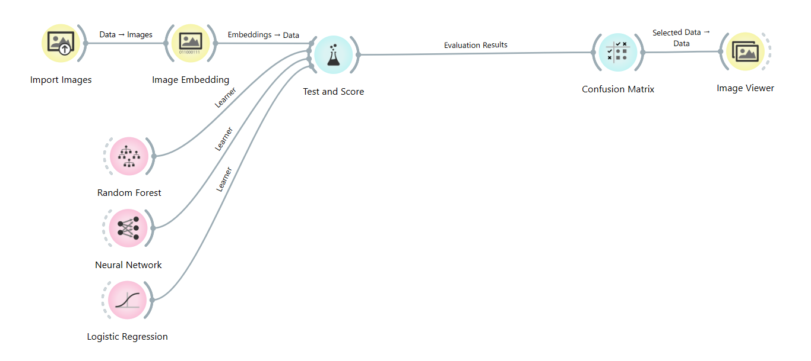
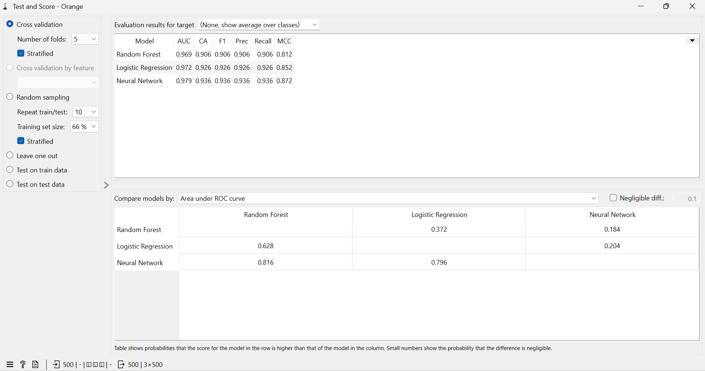
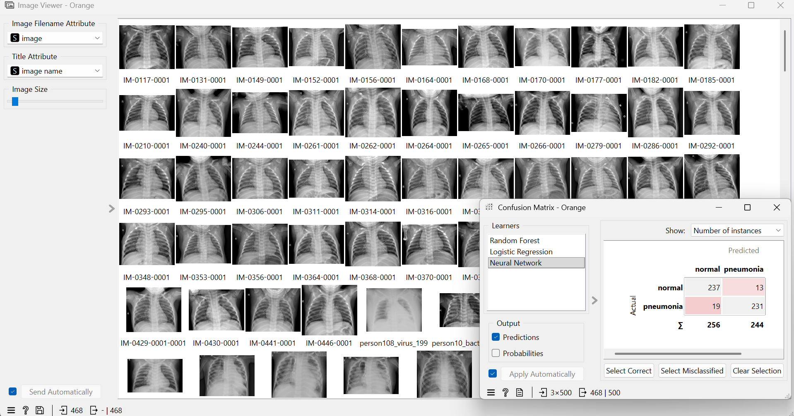

# Pneumonia Detection from X-Rays (Orange Data Mining)

A visual machine learning workflow built in **Orange Data Mining** using deep image embeddings and supervised classification models to distinguish **Normal** X-rays from **Pneumonia** (bacterial and viral) X-rays.

## Dataset Overview
- **Source:** [Chest X-Ray Images (Pneumonia) on Kaggle](https://kaggle.com)
- **Balanced Subset (500 Images):**
  - `NORMAL`: 250 images
  - `PNEUMONIA`: 250 images (125 Bacterial + 125 Viral)

## Workflow Architecture
1. **Import Images:** Loads the 500 labeled chest X-ray images across two classes.
2. **Image Embedding (SqueezeNet):** Extracts numerical feature representations from raw X-ray images using transfer learning.
3. **Model Evaluation (5-Fold Stratified Cross-Validation):** Compares three classifiers—**Neural Network**, **Logistic Regression**, and **Random Forest**—using `Test and Score`.
4. **Visual Error Auditing:** Pairs `Confusion Matrix` with `Image Viewer` to inspect individual X-ray classifications.

## Model Performance Results

| Model | AUC | Classification Accuracy (CA) | F1 Score | Precision | Recall | MCC |
| :--- | :---: | :---: | :---: | :---: | :---: | :---: |
| **Neural Network** | **0.979** | **93.6%** | **0.936** | **0.936** | **0.936** | **0.872** |
| **Logistic Regression** | 0.972 | 92.6% | 0.926 | 0.926 | 0.926 | 0.852 |
| **Random Forest** | 0.969 | 90.6% | 0.906 | 0.906 | 0.906 | 0.812 |

## Confusion Matrix & Visual Inspection

- **468 / 500 Correct Predictions** using the Neural Network model:
  - **237 / 250** Normal X-rays correctly identified (13 false positives)
  - **231 / 250** Pneumonia X-rays correctly identified (19 false negatives)

## How to Run Locally
1. Install [Orange Data Mining](https://orangedatamining.com) and enable the **Image Analytics** add-on (`Options > Add-ons`).
2. Download the Kaggle dataset and create a `dataset/` folder containing `NORMAL/` and `PNEUMONIA/` subfolders.
3. Open `Pneumonia Detection from X-Rays.ows` in Orange and point **Import Images** to your `dataset/` folder.

---
> **NOTE:** Built purely for educational exploration and skill-building. Not a certified medical device and not intended for clinical diagnosis or real patient care.
